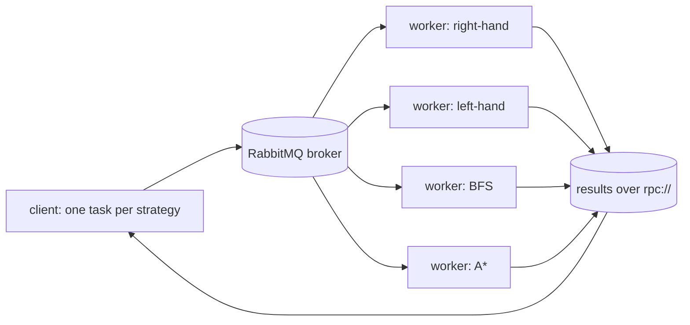
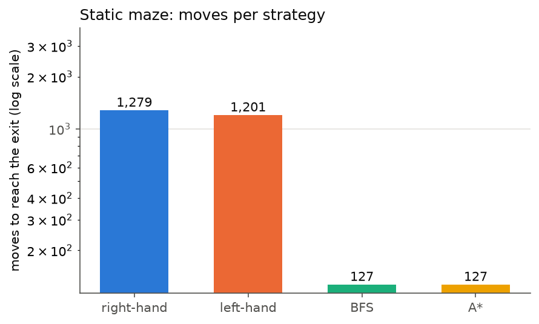
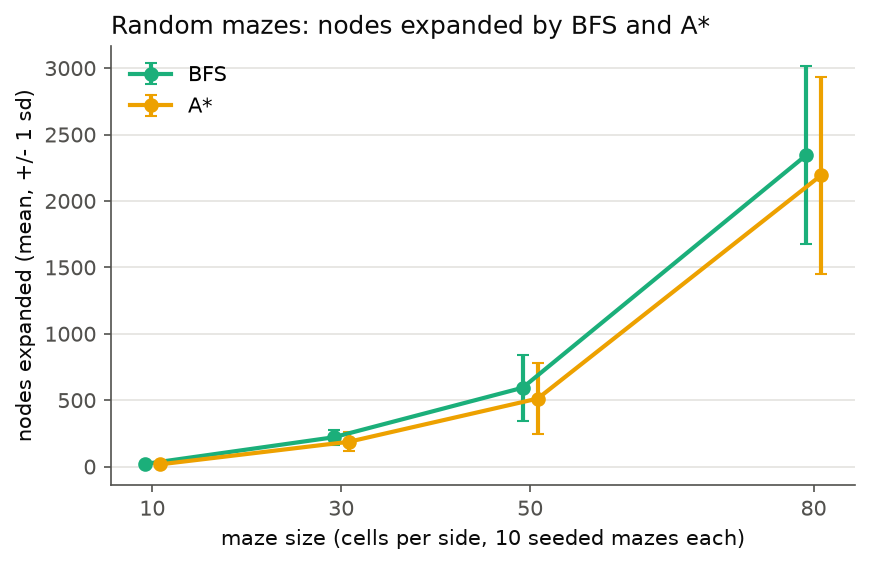
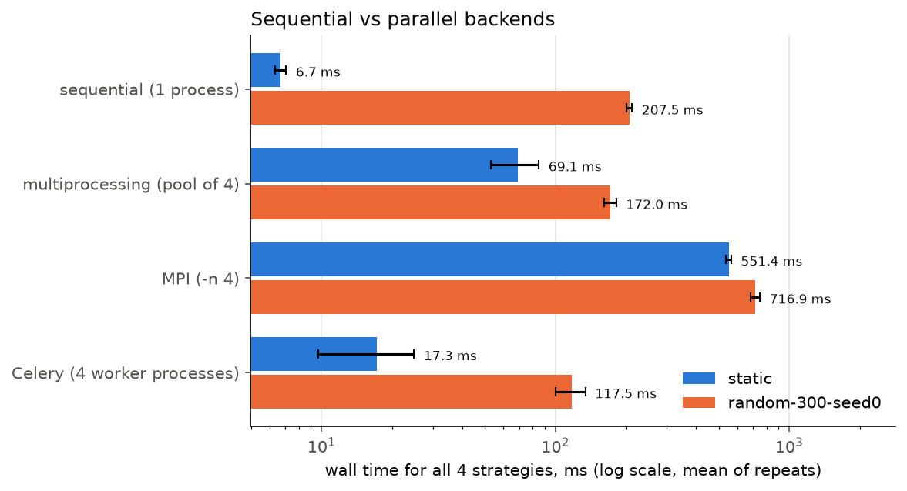

# Maze pathfinding, sequential and distributed

I compare four ways of getting through a maze (two wall followers, BFS and A*) and run them in parallel with multiprocessing, MPI and Celery + RabbitMQ.

Originally built for DSAI3202 Parallel & Distributed Computing, UDST, Spring 2025. Fixed and extended in 2026.

## In plain English

- **What it is:** a small maze game from my parallel computing course, plus my own solvers and three ways to run them in parallel.
- **The problem:** the explorer the course gave us follows the right-hand wall and needs 1,279 moves on the course's fixed maze. I wanted the shortest route, and to see what running the solvers in parallel really buys.
- **How it works:** a maze (a grid of walls and open cells, with an entrance and an exit) goes in. Four strategies search it, either one after another or spread over processes, MPI ranks or Celery workers. Out come the moves, the search effort and the timings, saved to `results/`.
- **2025 vs 2026:** in 2025 I wrote BFS, A* and the parallel runners, but my BFS and A* solved their own copies of the maze with different start and exit cells, so the comparison was invalid. In 2026 a review I ran found the problem, and a rebuild implemented by Claude Code from my specification pointed them at the real maze, fixed the timing and the parallel comparison, and added tests, CI and Docker.
- **Main result:** on the real maze BFS and A* both find the shortest route, 127 moves, 90.1% fewer than the wall follower. Caveat: the parallel versions are slower than running sequentially on small mazes, because start-up costs more than the search itself.
- **Why it matters:** shortest-path search and task queues are the same building blocks used in route planning and logistics, which is the kind of work I want to do in Qatar.

Demo video: _placeholder, I will record this myself and add the link here._


## Problem

The course gave us a Pygame maze game with an automatic explorer that keeps its right hand on the wall. It always gets out, but it walks into every dead end on the way. The assignment asked us to run several explorers in parallel, compare them, improve the explorer, and reach the exit of the fixed ("static") maze in 130 moves or fewer.

## Data

There is no external data. Mazes are made by code:

- the **static maze** from the course: 48 rows x 62 columns, entrance at (row 0, col 11), exit at (row 47, col 13). It has loops, so wall following is far from the shortest route.
- **random mazes** from the course's generator (depth-first carving), which the 2026 rebuild changed to accept a seed. The benchmark uses sizes 10, 30, 50 and 80 with seeds 0 to 9, so every maze can be rebuilt exactly. These mazes have no loops, so there is exactly one route between two cells.

## Method

| Strategy | Who wrote it | Idea |
|---|---|---|
| right-hand | course staff | keep the right hand on the wall |
| left-hand | 2026 rebuild (Claude Code, my spec) | the same explorer with its two turns swapped |
| BFS | me (2025); rebuilt 2026 with Claude Code | search outwards in rings; shortest route guaranteed |
| A* | me (2025); rebuilt 2026 with Claude Code | like BFS but tries cells closer to the exit first (Manhattan distance) |

Every returned route is checked: it must start at the entrance, end at the exit, use only open cells and move one cell up, down, left or right at a time. "Moves" is the number of steps (cells in the route minus one). "Nodes expanded" is how many cells BFS or A* took off their queue. For the wall followers, which have no queue, it is the number of different cells they stood on.

For the parallel runs every worker gets **the same maze and a different strategy**, and reports a fingerprint of the maze it solved, so the results can be compared. Timings use `time.perf_counter` around the search only (no drawing), 5 repeats, mean ± standard deviation.



MPI works the same way without a broker: rank 0 builds the maze, broadcasts it, each rank solves its share of the strategies, and rank 0 gathers the results.

## Results

All numbers below come from `results/summary.json`, made by `python scripts/run_benchmarks.py` on a 4-core Linux cloud machine (Intel Xeon, 15.7 GB RAM, Python 3.12.3, Open MPI 4.1.6, RabbitMQ 3.12.1). `scripts/check_readme_claims.py` fails CI if any table here stops matching that file.

### Static maze

<!-- claims:headline -->
| Static maze | Moves |
|---|---|
| Right-hand explorer (provided) | 1,279 |
| BFS (mine, fixed) | 127 |
| A* (mine, fixed) | 127 |
| Reduction vs right-hand | 90.1% |
<!-- /claims -->

<!-- claims:static -->
| Strategy | Moves | Nodes expanded | Backtracks | Time ms (mean ± sd, 5 runs) |
|---|---|---|---|---|
| right-hand | 1,279 | 862 | 0 | 1.95 ± 0.38 |
| left-hand | 1,201 | 802 | 0 | 1.69 ± 0.31 |
| BFS | 127 | 1,224 | - | 1.38 ± 0.07 |
| A* | 127 | 739 | - | 1.29 ± 0.07 |
<!-- /claims -->



BFS and A* return the same length and A* expands fewer cells (739 vs 1,224) because it tries cells nearer the exit first. The explorer never backtracks: its backtracking check can never trigger (see "What went wrong").

### Random mazes (10 seeded mazes per size)

<!-- claims:random -->
| Size | Strategy | Moves (mean ± sd) | Nodes expanded (mean ± sd) |
|---|---|---|---|
| 10 | right-hand | 21.2 ± 15.1 | 17.3 ± 7.9 |
| 10 | left-hand | 19.6 ± 12.4 | 16.5 ± 6.8 |
| 10 | BFS | 11.4 ± 4.2 | 19.7 ± 6.0 |
| 10 | A* | 11.4 ± 4.2 | 16.6 ± 6.9 |
| 30 | right-hand | 370.0 ± 213.9 | 225.3 ± 107.4 |
| 30 | left-hand | 288.4 ± 194.7 | 184.5 ± 103.8 |
| 30 | BFS | 78.6 ± 22.2 | 220.6 ± 58.1 |
| 30 | A* | 78.6 ± 22.2 | 186.5 ± 72.1 |
| 50 | right-hand | 1015.5 ± 589.7 | 621.2 ± 299.3 |
| 50 | left-hand | 774.7 ± 612.3 | 500.8 ± 301.4 |
| 50 | BFS | 224.9 ± 122.7 | 593.5 ± 246.7 |
| 50 | A* | 224.9 ± 122.7 | 512.1 ± 264.8 |
| 80 | right-hand | 3447.8 ± 1539.9 | 2127.3 ± 750.0 |
| 80 | left-hand | 3161.8 ± 1310.6 | 1984.3 ± 629.9 |
| 80 | BFS | 804.8 ± 350.4 | 2343.5 ± 670.4 |
| 80 | A* | 804.8 ± 350.4 | 2193.3 ± 743.0 |
<!-- /claims -->

<!-- claims:ratio -->
| Size | Mazes | A* nodes / BFS nodes (mean ± sd) |
|---|---|---|
| 10 | 10 | 0.837 ± 0.195 |
| 30 | 10 | 0.818 ± 0.157 |
| 50 | 10 | 0.833 ± 0.164 |
| 80 | 10 | 0.916 ± 0.086 |
<!-- /claims -->



A* expands fewer cells than BFS on every size, but only by about 8 to 18% on average. These mazes have no loops and long winding corridors, so the straight-line distance to the exit is a weak hint. On the static maze, which has loops, A* saves more.

### Sequential vs parallel

<!-- claims:backends -->
| Maze | Backend | Total wall ms (mean ± sd) | Work phase only ms | Repeats |
|---|---|---|---|---|
| static | sequential (1 process) | 6.70 ± 0.37 | - | 5 |
| static | multiprocessing (pool of 4) | 69.11 ± 15.95 | 47.27 ± 4.93 | 5 |
| static | MPI (-n 4) | 551.36 ± 13.98 | 3.66 ± 1.79 | 5 |
| static | Celery (4 worker processes) | 17.28 ± 7.62 | - | 5 |
| random-300-seed0 | sequential (1 process) | 207.47 ± 5.41 | - | 5 |
| random-300-seed0 | multiprocessing (pool of 4) | 171.98 ± 10.22 | 154.83 ± 9.07 | 5 |
| random-300-seed0 | MPI (-n 4) | 716.94 ± 32.44 | 101.51 ± 17.66 | 5 |
| random-300-seed0 | Celery (4 worker processes) | 117.47 ± 17.04 | - | 5 |
<!-- /claims -->

"Work phase only" leaves out start-up: `pool.map` time for multiprocessing, barrier-to-gather time inside the MPI job. Celery workers were already running, so its total has no start-up.



Every backend returns identical move counts, which is only possible because they all solved the same maze:

<!-- claims:backend_moves -->
| Maze | Strategy | sequential | multiprocessing | mpi | celery |
|---|---|---|---|---|---|
| static | right-hand | 1,279 | 1,279 | 1,279 | 1,279 |
| static | left-hand | 1,201 | 1,201 | 1,201 | 1,201 |
| static | BFS | 127 | 127 | 127 | 127 |
| static | A* | 127 | 127 | 127 | 127 |
| random-300-seed0 | right-hand | 54,366 | 54,366 | 54,366 | 54,366 |
| random-300-seed0 | left-hand | 9,450 | 9,450 | 9,450 | 9,450 |
| random-300-seed0 | BFS | 3,422 | 3,422 | 3,422 | 3,422 |
| random-300-seed0 | A* | 3,422 | 3,422 | 3,422 | 3,422 |
<!-- /claims -->

What this shows, honestly: for the static maze all four searches together take a few milliseconds, so every parallel version is slower than running them one after another. MPI is slowest overall because `mpiexec` has to start four Python interpreters, even though its work phase is only a few milliseconds. On the 300 x 300 maze Celery (already-running workers) and multiprocessing beat sequential, but not by 4x: with four jobs of very different length, the longest one (the right-hand explorer) decides when the parallel run finishes.

### 2025 coursework (as submitted, not comparable)

These are the numbers I submitted in 2025, from `results.csv` in my course repository (branch A2, commit 55c6022). They are **not** checked against `results/` and should not be compared with the tables above.

| 2025 row | Moves | Time | Why it is not comparable |
|---|---|---|---|
| explorer, static maze | 1279 | 43.02 s | the time was a run with the display on |
| A* | 102 | 0.000998 s | different start and exit cell from the real maze |
| BFS | 119 | 0.001502 s | an edited copy of the maze, different exit, and moves counted one too many |

## What went wrong and how it was fixed

- **Wrong goals (bug B44).** My 2025 BFS and A* each had their own pasted copy of the maze with a different start and exit, and the BFS copy had six edited rows. So "1,279 moves down to 102/119" compared three different problems. Now both read the maze, entrance and exit from the game (`MazeProblem.from_maze`), with one helper converting the game's (x, y) into (row, col). Both return 127 on the real maze, and a regression test fails on the 2025 files.
- **Timing included the display (B45, B47).** My BFS timer ran around a 3-second pygame window, and the 2025 explorer time of 43 s was a run with the display on. The timer now stops before anything is drawn. The rebuild also removed a fake "backtracks = moves - 1" number from BFS.
- **Results appended instead of replaced (B46).** Each run added rows to `results.csv`. Now one script writes all result files fresh.
- **Identical explorers (B48, B51).** In 2025 my MPI and multiprocessing runs gave every worker the same explorer on the same maze, so "best explorer" was timing noise, and my Celery task built a new random maze for every worker. Now each worker gets the same maze and a different strategy, and the results are checked by maze fingerprint.
- **Screenshot not reproducible.** My 2025 Celery screenshot showed four identical 21-move results in a format the committed code does not print. Instead of screenshots, results now come from scripts, with the machine and versions saved next to them.
- **Smaller fixes.** Celery tasks now expire and the client says "start the worker first" instead of hanging (B49). Backtracks are reported, not hard-coded to 0 (B50). mpi4py and celery are in the pinned requirements (B52). pygame is only imported when a window is opened, so everything runs headless (B53).
- **Found during the 2026 rebuild.** Property tests found that the course explorer walks through walls when the start cell has no open neighbour; it now stops instead. Reading the explorer showed its backtracking can never run, which is why the real backtrack count is 0 (I wrote 30 in 2025). Collecting Celery results one by one sometimes stalled for 1 to 2 seconds, and a `fork` process pool broke an open Celery connection. Both are fixed and explained in `docs/DECISIONS.md`.

## Limitations

- MPI was tested on one machine in 2026 (2 and 4 ranks). This repository does not show MPI across several machines.
- The mazes are small, so start-up overhead dominates the parallel timings. The comparison shows overhead more than speed-up.
- Timings depend on the machine; they come from one 4-core cloud machine. Move counts and nodes expanded do not change between machines or runs.
- The random mazes have no loops, which makes A*'s advantage over BFS small there.
- Docker compose was not run on the machine that produced `results/`. The compose smoke test (RabbitMQ, a worker and a client that writes its results) passed in GitHub Actions: https://github.com/maryam843/maze-pathfinding-distributed/actions/runs/36753513866
- The wall followers' "nodes" are distinct cells visited, not queue expansions, so they are not directly comparable with BFS and A*.
- Windows CI runs 149 of the 153 tests by design: the fork and forkserver start-method cases do not exist on Windows, and 10 of the 149 skip because MPI and RabbitMQ are not installed on the Windows runner.

## What I learned

- A comparison is only as good as its setup: I had compared three different problems in 2025 without noticing.
- Always check where a timer starts and stops. Mine was measuring a window staying open for 3 seconds.
- Parallel does not mean faster. For small tasks, starting processes costs more than the work.
- Mixing (x, y) and (row, col) is an easy way to solve the wrong maze; converting in one place fixed it.
- Property-based tests find cases hand-written tests miss, like a start cell with no way out.
- Process start methods matter: forking a process that holds a network connection can break that connection.
- Asking for tests that fail on my old code was the clearest way to show what each fix changed.

## How to run

Python 3.12. From the repository root:

```bash
python -m venv .venv
source .venv/bin/activate          # Windows: .venv\Scripts\activate
pip install -r requirements.txt -r requirements-dev.txt
```

Solve mazes locally (no services needed):

```bash
python -m maze_runner --maze static
python -m maze_runner --maze random --size 50 --seed 3 --strategy astar --json out/astar_random50.json
python -m maze_runner.backends.multiproc --maze static
```

Regenerate every result, figure and the GIF, then check the README against them and run the tests:

```bash
python scripts/run_benchmarks.py
python scripts/make_figures.py
python scripts/make_gif.py
python scripts/check_readme_claims.py
python -m pytest
```

`run_benchmarks.py` writes `results/*.csv` and `results/summary.json`; `make_figures.py` writes `figures/static_moves.png`, `figures/nodes_vs_size.png` and `figures/backends.png`; `make_gif.py` writes `figures/astar_static.gif`. Backends that cannot run (no `mpiexec`, no Celery worker) are listed as "not run" in `summary.json` instead of failing.

MPI (needs Open MPI or MPICH; MS-MPI on Windows):

```bash
mpiexec -n 4 python -m maze_runner.backends.mpi_run --maze static --out out/mpi_static.json
```

Celery (needs RabbitMQ on localhost; start the worker first, in its own terminal):

```bash
celery -A maze_runner.backends.celery_app worker -c 4 --loglevel=info
python -m maze_runner.backends.celery_client --maze static --out out/celery_static.json
```

Docker (RabbitMQ, one worker with 4 processes, and a client that runs the Celery benchmark and writes `results/docker/*.json`):

```bash
docker compose -f docker/docker-compose.yml up --build --abort-on-container-exit --exit-code-from client
```

Optional settings: `CELERY_BROKER_URL` (default `pyamqp://guest@localhost//`), `MAZE_MP_START_METHOD` (`spawn`, `forkserver` or `fork`), `MPIEXEC` and `MPIEXEC_FLAGS`, and `MAZE_REGRESSION_TARGET=legacy` to run the regression tests against the 2025 files (they all fail there, on purpose).

## Repository layout

```
src/maze_runner/       maze.py, explorer.py, constants.py (course files, attributed), strategies.py,
                       benchmark.py, viz.py, cli.py, backends/ (multiproc, mpi_run, celery_*)
scripts/               run_benchmarks, make_figures, make_gif, check_readme_claims, pii_scan
tests/                 unit, property (hypothesis), regression, integration
original_2025/         my 2025 submission as it was, plus the course files it needs
results/ figures/      generated by the scripts above
docker/ docs/          Dockerfile + compose; DECISIONS.md
```

## How this was built

- 2025: I wrote BFS, A* and the multiprocessing, MPI and Celery runners for the DSAI3202 assignment. That code is unchanged in `original_2025/` and in the first commit. The course staff provided the maze game and the right-hand explorer.
- 2026: a review I ran found that my solvers had solved the wrong copy of the maze. The rebuild in the rest of this repository was implemented by Claude Code from my written specification; I directed it, reviewed the results and decided what to fix.
- Course staff files are credited below, each with a header saying what was changed and when.
- The commit history matches this: the first commit is my 2025 code, every later commit is the 2026 rebuild.

## Credits

The maze game is by the DSAI3202 course staff (UDST, Spring 2025); the instructor asked students to keep coursework public. Each course file has a header saying whether it was changed, by me in 2025 or in the 2026 rebuild:

- `src/maze_runner/maze.py` (modified: optional seed)
- `src/maze_runner/explorer.py` (modified: lazy pygame import, optional printing, cycle guard, no step into a wall)
- `src/maze_runner/constants.py` (modified in 2025: frame rate)
- `original_2025/main.py`, `original_2025/requirements.txt`, `original_2025/src/{__init__,maze,game,player,constants,explorer}.py` (as provided or with my 2025 changes)

My 2025 code is in `original_2025/` (BFS, A*, and the multiprocessing, MPI and Celery runners). Everything else in this repository (the `maze_runner` package including the left-hand explorer, the benchmark, tests, figures, CI and Docker setup) was implemented in 2026 by Claude Code from my written specification, which I directed and reviewed.

## Licence

The code in this repository, apart from the course files, is under the MIT licence (see `LICENSE`). The course files listed above belong to the course staff.
