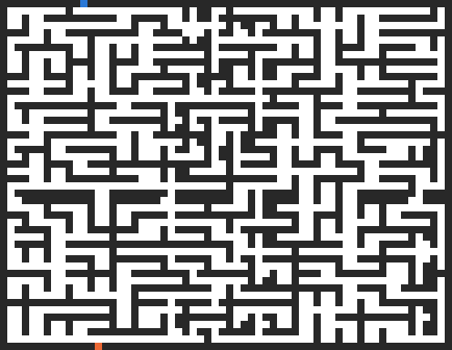

# Maze pathfinding, sequential and distributed
[](https://github.com/maryam843/maze-pathfinding-distributed/actions/workflows/ci.yml)

Four maze strategies (right-hand and left-hand wall followers, BFS and A*) run one after another and in parallel with multiprocessing, MPI and Celery on RabbitMQ, with a measurement of what the parallel runs actually buy.

## Key results

- On the 48 x 62 static maze BFS and A* both find the shortest route, **127 moves**, against 1,279 for the right-hand wall follower (90.1% fewer) and 1,201 for the left-hand one.
- A* expands **739 cells against 1,224 for BFS** on the static maze (39.6% fewer). On 40 seeded random mazes, which have no loops, the saving is only 8% to 18% on average.
- On the small static maze **every parallel back end is slower than one process**: 6.70 ms sequential against 17.28 ms (Celery), 69.11 ms (multiprocessing) and 551.36 ms (MPI). Start-up costs more than the search.
- On one 300 x 300 maze Celery was 1.77x and multiprocessing 1.21x faster than sequential, and MPI was 0.29x (slower). This is one maze, 5 repeats, one 4-core machine, with the Celery workers already running.



**Tools:** Python, multiprocessing, MPI (mpi4py), Celery, RabbitMQ, Docker, pytest, Hypothesis, matplotlib, GitHub Actions

## Data

There is no external dataset and nothing to download. Every maze is made by code in [`src/maze_runner/maze.py`](src/maze_runner/maze.py):

- **Static maze:** a fixed 48 x 62 grid (1,560 open cells) with the entrance at (row 0, col 11) and the exit at (row 47, col 13). It has loops, so wall following is far from the shortest route. The pattern was supplied with the original exercise.
- **Random mazes:** carved depth-first with a seeded random number generator, so each one can be rebuilt exactly. The benchmark uses sizes 10, 30, 50 and 80 with seeds 0 to 9 (40 mazes), plus one 300 x 300 maze (seed 0) for the parallel runs. These mazes have no loops, so there is exactly one route between two cells.

The benchmark output (6 CSV files and `summary.json`) is committed in [`results/`](results/) together with the machine and library versions that produced it.

## Approach

1. Turn every maze into one immutable `MazeProblem`. The supplied game stores positions as (x, y) while grids are indexed [row][col], so one helper (`to_row_col`) does the conversion in one place.
2. Solve it with four strategies: the supplied right-hand wall follower as the baseline, a left-hand variant (the same explorer with its two turns swapped), BFS, and A* with the Manhattan distance.
3. Check every returned route: it starts at the entrance, ends at the exit, uses only open cells and moves one cell at a time.
4. Count moves (route length), nodes expanded (cells taken off the queue for BFS and A*, distinct cells visited for the wall followers) and backtracks.
5. Time the search only, with `time.perf_counter` and no drawing, 5 repeats, mean and sample standard deviation.
6. Run the same four jobs sequentially, in a process pool of 4, over 4 MPI ranks (rank 0 broadcasts the maze and gathers results) and through 4 Celery worker processes. Every worker gets the same maze and a different strategy, and reports a fingerprint of the maze it solved, so the back ends can be compared fairly.
7. Write all results fresh on every run (never appended) and check the README tables against them in CI.

## Results

Static maze, all strategies against the right-hand baseline (`results/static_maze.csv`, `results/summary.json`):

<!-- claims:static -->
| Strategy | Moves | Nodes expanded | Backtracks | Time ms (mean ± sd, 5 runs) |
|---|---|---|---|---|
| right-hand | 1,279 | 862 | 0 | 1.95 ± 0.38 |
| left-hand | 1,201 | 802 | 0 | 1.69 ± 0.31 |
| BFS | 127 | 1,224 | - | 1.38 ± 0.07 |
| A* | 127 | 739 | - | 1.29 ± 0.07 |
<!-- /claims -->

The supplied explorer never backtracks: its backtracking check can never trigger, which a test in `tests/test_maze_explorer.py` shows. Results were made by `python scripts/run_benchmarks.py` on a 4-core Linux cloud machine (Intel Xeon, 15.7 GB RAM, Python 3.12.3, Open MPI 4.1.6). `scripts/check_readme_claims.py` fails CI if any table in this README stops matching `results/summary.json`.

<details>
<summary>Random mazes, sequential vs parallel, and moves per back end</summary>

<!-- claims:headline -->
| Static maze | Moves |
|---|---|
| Right-hand explorer (provided) | 1,279 |
| BFS (mine, fixed) | 127 |
| A* (mine, fixed) | 127 |
| Reduction vs right-hand | 90.1% |
<!-- /claims -->

Random mazes, 10 seeded mazes per size:

<!-- claims:random -->
| Size | Strategy | Moves (mean ± sd) | Nodes expanded (mean ± sd) |
|---|---|---|---|
| 10 | right-hand | 21.2 ± 15.1 | 17.3 ± 7.9 |
| 10 | left-hand | 19.6 ± 12.4 | 16.5 ± 6.8 |
| 10 | BFS | 11.4 ± 4.2 | 19.7 ± 6.0 |
| 10 | A* | 11.4 ± 4.2 | 16.6 ± 6.9 |
| 30 | right-hand | 370.0 ± 213.9 | 225.3 ± 107.4 |
| 30 | left-hand | 288.4 ± 194.7 | 184.5 ± 103.8 |
| 30 | BFS | 78.6 ± 22.2 | 220.6 ± 58.1 |
| 30 | A* | 78.6 ± 22.2 | 186.5 ± 72.1 |
| 50 | right-hand | 1015.5 ± 589.7 | 621.2 ± 299.3 |
| 50 | left-hand | 774.7 ± 612.3 | 500.8 ± 301.4 |
| 50 | BFS | 224.9 ± 122.7 | 593.5 ± 246.7 |
| 50 | A* | 224.9 ± 122.7 | 512.1 ± 264.8 |
| 80 | right-hand | 3447.8 ± 1539.9 | 2127.3 ± 750.0 |
| 80 | left-hand | 3161.8 ± 1310.6 | 1984.3 ± 629.9 |
| 80 | BFS | 804.8 ± 350.4 | 2343.5 ± 670.4 |
| 80 | A* | 804.8 ± 350.4 | 2193.3 ± 743.0 |
<!-- /claims -->

<!-- claims:ratio -->
| Size | Mazes | A* nodes / BFS nodes (mean ± sd) |
|---|---|---|
| 10 | 10 | 0.837 ± 0.195 |
| 30 | 10 | 0.818 ± 0.157 |
| 50 | 10 | 0.833 ± 0.164 |
| 80 | 10 | 0.916 ± 0.086 |
<!-- /claims -->

Sequential vs parallel, wall time for all four strategies. "Work phase only" leaves out start-up (`pool.map` for multiprocessing, barrier to gather inside the MPI job). The Celery workers were already running, so its total has no start-up.

<!-- claims:backends -->
| Maze | Backend | Total wall ms (mean ± sd) | Work phase only ms | Repeats |
|---|---|---|---|---|
| static | sequential (1 process) | 6.70 ± 0.37 | - | 5 |
| static | multiprocessing (pool of 4) | 69.11 ± 15.95 | 47.27 ± 4.93 | 5 |
| static | MPI (-n 4) | 551.36 ± 13.98 | 3.66 ± 1.79 | 5 |
| static | Celery (4 worker processes) | 17.28 ± 7.62 | - | 5 |
| random-300-seed0 | sequential (1 process) | 207.47 ± 5.41 | - | 5 |
| random-300-seed0 | multiprocessing (pool of 4) | 171.98 ± 10.22 | 154.83 ± 9.07 | 5 |
| random-300-seed0 | MPI (-n 4) | 716.94 ± 32.44 | 101.51 ± 17.66 | 5 |
| random-300-seed0 | Celery (4 worker processes) | 117.47 ± 17.04 | - | 5 |
<!-- /claims -->

Every back end returns identical move counts, which shows they all solved the same maze:

<!-- claims:backend_moves -->
| Maze | Strategy | sequential | multiprocessing | mpi | celery |
|---|---|---|---|---|---|
| static | right-hand | 1,279 | 1,279 | 1,279 | 1,279 |
| static | left-hand | 1,201 | 1,201 | 1,201 | 1,201 |
| static | BFS | 127 | 127 | 127 | 127 |
| static | A* | 127 | 127 | 127 | 127 |
| random-300-seed0 | right-hand | 54,366 | 54,366 | 54,366 | 54,366 |
| random-300-seed0 | left-hand | 9,450 | 9,450 | 9,450 | 9,450 |
| random-300-seed0 | BFS | 3,422 | 3,422 | 3,422 | 3,422 |
| random-300-seed0 | A* | 3,422 | 3,422 | 3,422 | 3,422 |
<!-- /claims -->

Figures: [moves per strategy](figures/static_moves.png), [nodes expanded by BFS and A*](figures/nodes_vs_size.png), [back end wall times](figures/backends.png).

</details>

## Limitations

- The speed-up figures rest on one 300 x 300 maze, 5 repeats and one 4-core cloud machine. Millisecond timings change from machine to machine; move and node counts do not.
- The parallel runs are four uneven jobs, so the slowest one (the right-hand follower) sets the finish time. This measures start-up and imbalance, not a parallel search, and "distributed" here means separate processes and a broker on one host, not a cluster.
- The mazes are small, unweighted and mostly loop-free, which leaves A* little room to save work. On the 300 x 300 maze A* is slower than BFS in wall time even though it expands fewer cells.
- Timings are mean and sample standard deviation of 5 repeats, with no significance test. The Docker image covers Celery only, not MPI.

## How to run

Python 3.12. From the repository root:

```bash
python -m venv .venv
source .venv/bin/activate          # Windows: .venv\Scripts\activate
pip install -r requirements.txt -r requirements-dev.txt
```

Solve mazes locally (no services needed):

```bash
python -m maze_runner --maze static
python -m maze_runner --maze random --size 50 --seed 3 --strategy astar --json out/astar_random50.json
python -m maze_runner.backends.multiproc --maze static
```

Regenerate results, figures and the GIF (written to `out/`, so the committed `results/` and `figures/` stay as they are), check the README tables and run the tests:

```bash
python scripts/run_benchmarks.py
python scripts/make_figures.py
python scripts/make_gif.py
python scripts/check_readme_claims.py
python -m pytest
```

`check_readme_claims.py` compares against the committed `results/` by default; add `--results out/results` to compare your own run (timings differ by machine, moves and nodes must match). Back ends that cannot run (no `mpiexec`, no Celery worker) are listed as "not run" in `summary.json` instead of failing. CI also runs `ruff check .`, `ruff format --check .` and `python scripts/pii_scan.py`.

MPI (needs Open MPI or MPICH; MS-MPI on Windows; add `--oversubscribe` on a machine with fewer than 4 cores):

```bash
mpiexec -n 4 python -m maze_runner.backends.mpi_run --maze static --out out/mpi_static.json
```

Celery (needs RabbitMQ on localhost; start the worker first, in its own terminal):

```bash
celery -A maze_runner.backends.celery_app worker -c 4 --loglevel=info
python -m maze_runner.backends.celery_client --maze static --out out/celery_static.json
```

Docker (RabbitMQ, one worker with 4 processes, and a client that runs the Celery benchmark and writes `results/docker/*.json`). Create `results/docker` first and let the container user write to it; on Linux set `HOST_UID=$(id -u)` in front of the command, as the CI `docker` job does:

```bash
docker compose -f docker/docker-compose.yml up --build --abort-on-container-exit --exit-code-from client
```

Optional settings: `CELERY_BROKER_URL` (default `pyamqp://guest@localhost//`), `MAZE_MP_START_METHOD` (`spawn`, `forkserver` or `fork`), `MPIEXEC` and `MPIEXEC_FLAGS`.

The suite has 159 tests (unit, Hypothesis property, regression, integration with real MPI ranks and a real Celery worker, and README command tests), at 96.28% coverage on Linux CI. On the Windows CI runner 10 of the 155 tests skip, because MPI and RabbitMQ are not installed there.

## Repo structure

```
src/maze_runner/       maze.py, explorer.py, constants.py (supplied), strategies.py, benchmark.py,
                       viz.py, cli.py, backends/ (multiproc, mpi_run, celery_*)
scripts/               run_benchmarks, make_figures, make_gif, check_readme_claims, pii_scan
tests/                 unit, property, regression and integration tests
results/  figures/     committed benchmark output and the figures drawn from it
docker/                Dockerfile, compose file, RabbitMQ config
docs/DECISIONS.md      design choices with alternatives and trade-offs
.github/workflows/     ci.yml: lint, Linux and Windows tests, secret scan, compose smoke test
```

## Licence and credits

The code is under the MIT licence (see [`LICENSE`](LICENSE)), apart from the supplied files below.

`src/maze_runner/maze.py` (maze class, generator and static maze pattern), `src/maze_runner/explorer.py` (right-hand explorer) and `src/maze_runner/constants.py` were supplied with the original exercise. Each keeps a header that says so and lists what was changed here. BFS, A*, the left-hand explorer, the parallel runners, the benchmark, tests and CI are this project's own code.
